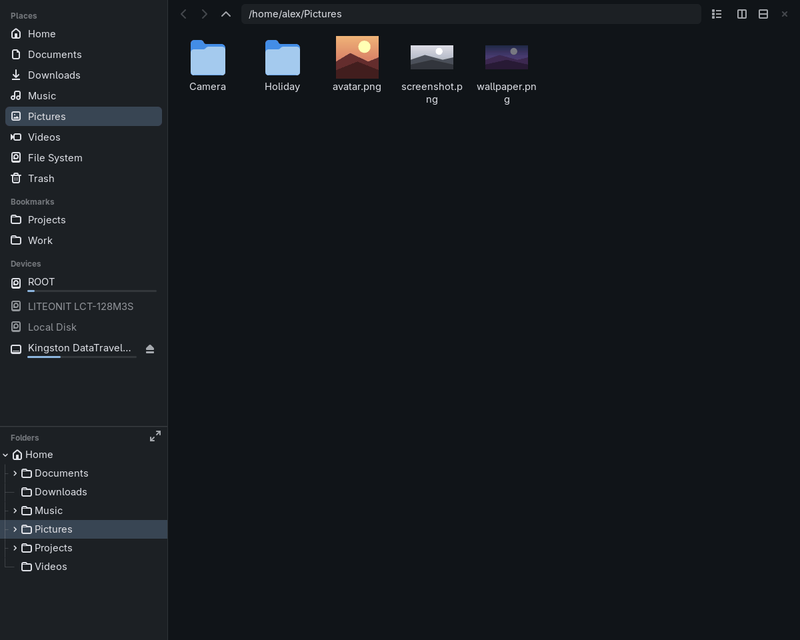

<p align="center"></p>

# sfe — Simple File Explorer



sfe is a small, fast file manager for Wayland, written in C with GTK3. It
aims to stay minimal and readable while covering what a daily file manager
needs: a sidebar with bookmarks, drives and a folder tree; up to three split
views; fuzzy search; thumbnails; copy, move, trash, undo and batch rename;
and custom commands. Everything also works from the keyboard, vim style,
with a `:` command line.

It follows your GTK theme and reloads colour schemes from tools like
Noctalia, matugen or pywal instantly. Drives mount without a root password
through UDisks2, and nothing depends on systemd, so it runs on Artix, Gentoo
and other OpenRC distributions too.

**[Read the user guide](docs/guide/index.md)** for every feature and
keyboard shortcut.

## Building and installing

```sh
meson setup build --prefix=/usr
ninja -C build
meson test -C build
./build/sfe [DIRECTORY...]          # try it without installing
sudo meson install -C build         # sfe, its .desktop file, icon, man page and guide
```

`sudo ninja -C build uninstall` removes it again. Installing adds sfe to
application launchers and lets *Settings → System* make it the default file
manager.

On Arch / Artix, `packaging/arch/PKGBUILD` builds a package with all runtime
dependencies listed:

```sh
cd packaging/arch
makepkg -si
```

Runtime dependencies: gtk3, glib2, udisks2 + polkit (mounting), xdg-utils
(opening files) and ffmpeg (video thumbnails); archive tools and thumbnailers
are optional. See the PKGBUILD for the full, annotated list.

## Documentation

- [The user guide](docs/guide/index.md), also installed to
  `/usr/share/doc/sfe/guide/index.md`
- `man sfe`
- Settings live in `~/.config/sfe/config.toml` (or Ctrl+P)

## License

sfe is released under the MIT license.

It statically links [tomlc17](https://github.com/cktan/tomlc17) by cktan
(MIT).
