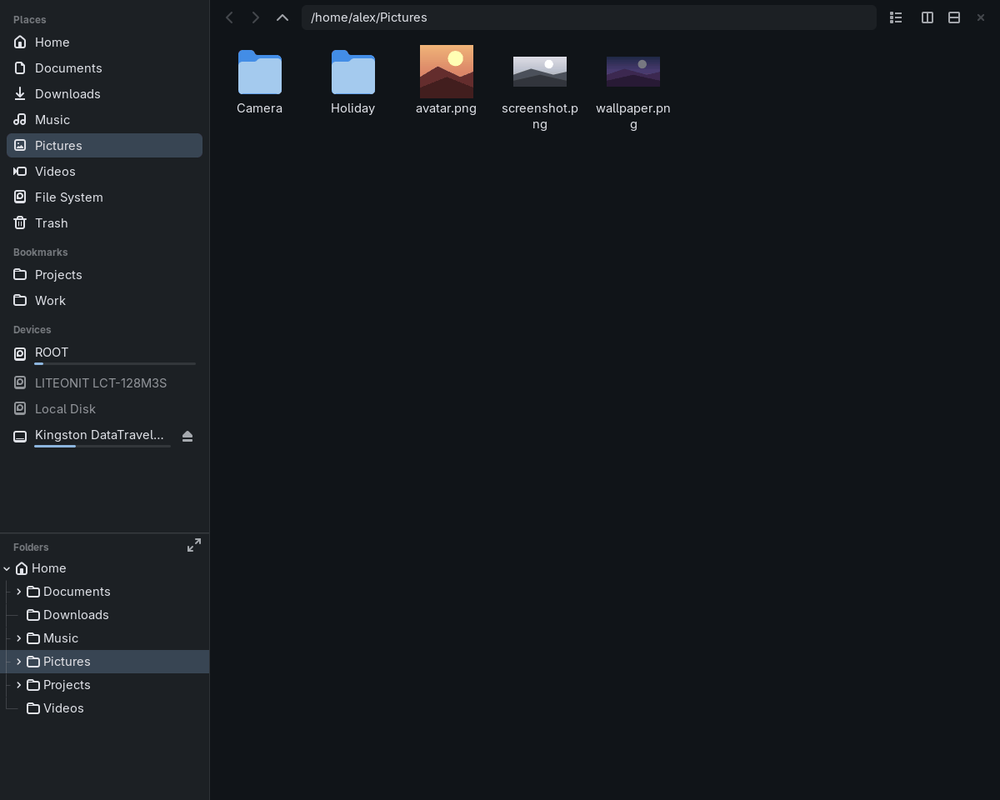
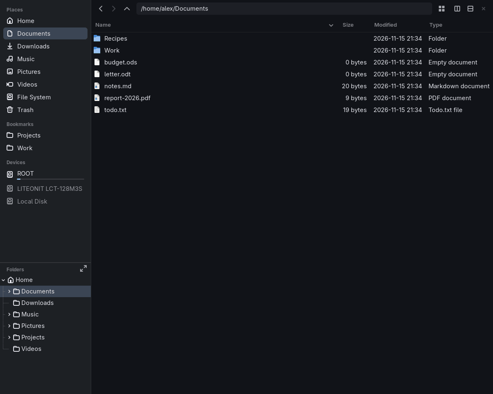
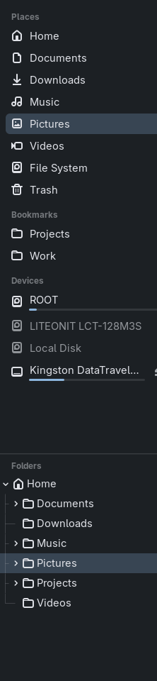
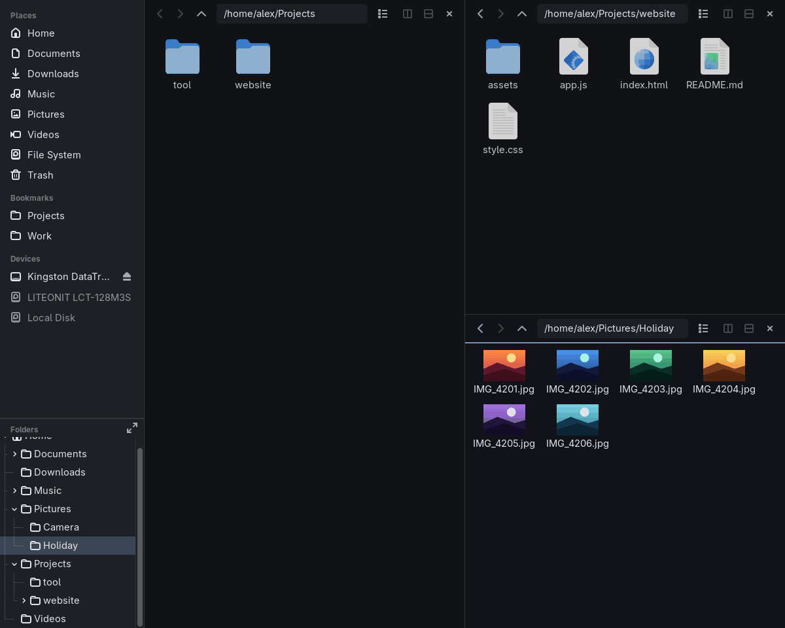
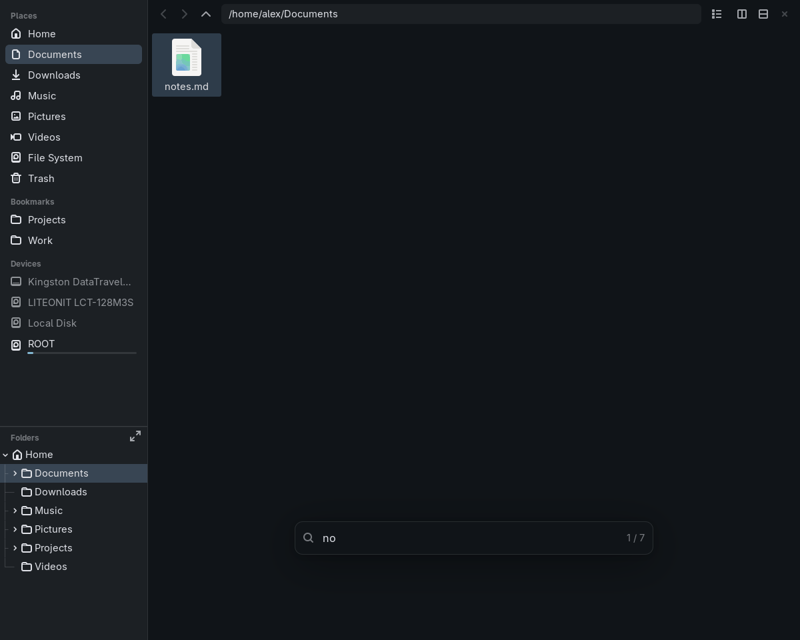
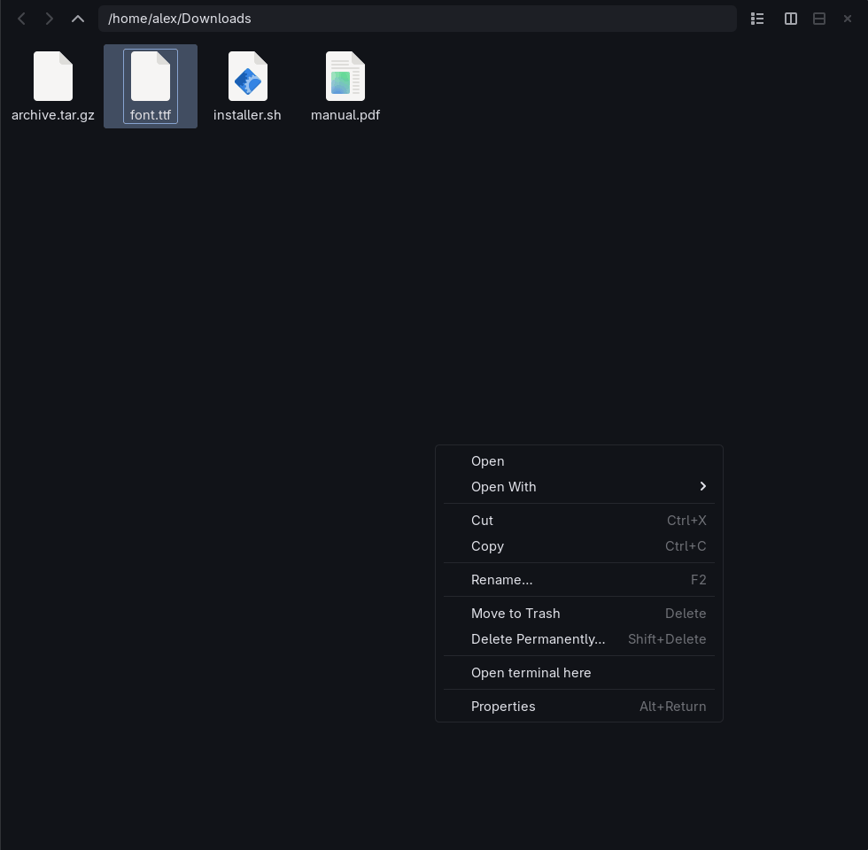
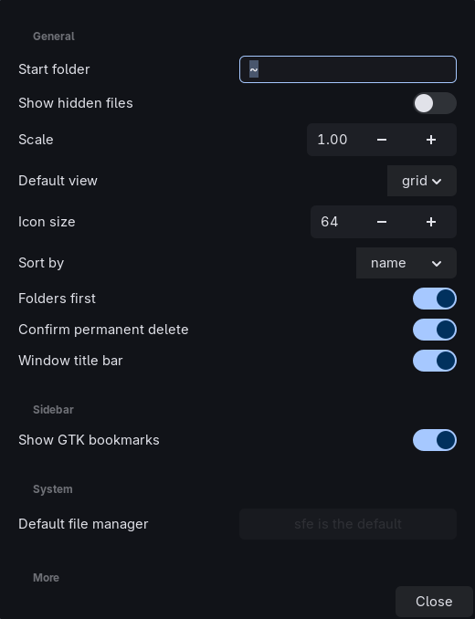

# sfe user guide

sfe (Simple File Explorer) is a fast, keyboard-friendly file manager for
Wayland. This guide covers every feature and every shortcut.



> Screenshots are generated by `docs/guide/tools/screenshots.sh` from a demo
> home folder. Colours follow your own GTK theme.

## Contents

- [The window](#the-window)
- [Moving around](#moving-around)
- [Views and sorting](#views-and-sorting)
- [Sidebar](#sidebar)
- [Split views](#split-views)
- [Search](#search)
- [Working with files](#working-with-files)
- [Renaming](#renaming)
- [Properties](#properties)
- [Drives](#drives)
- [Debugging](#debugging)
- [Configuration](#configuration)
- [Themes](#themes)
- [Keyboard shortcuts](#keyboard-shortcuts)

## The window

- **Sidebar** (left): places, bookmarks and drives in the top two thirds, a folder tree below. Drag the divider to resize them.
- **Path bar** (top of each view): back, forward and parent buttons, the full
  path, the grid/list toggle, and the split and close buttons.
- **Files**: the contents of the current folder.
- **Progress bar** (bottom): appears while longer copies run.

## Moving around

| Do this | Keys / mouse |
|---|---|
| Open a folder or file | double-click, Enter |
| Parent folder | Backspace, Alt+Up, ↑ button |
| Back / forward | Alt+Left / Alt+Right, mouse back/forward buttons |
| Type a path | Ctrl+L, then Enter (Tab completes folder names, Esc cancels) |
| Reload | F5, Ctrl+R |
| Show / hide hidden files | Ctrl+H |
| Clear the selection | Esc |
| New window | Ctrl+N |
| Quit | Ctrl+Q |

Files open in your default application (`xdg-open`). To use a specific
program for an extension, see [Configuration](#configuration).

## Views and sorting



- **Ctrl+1** grid view, **Ctrl+2** list view, or the toggle button.
- In the list view, click a column header to sort by it; click again to
  reverse. Folders always stay on top.

## Sidebar



- **Places**: Home, your standard folders, and File System.
- **Bookmarks**: **Ctrl+D**, or *Add to Bookmarks* in the menu of empty
  space, bookmarks the current folder (again to remove it); a selected
  folder can be bookmarked from its menu too. Drag bookmarks to reorder them; right-click → *Remove Bookmark*.
  Bookmarks from `~/.config/gtk-3.0/bookmarks` (Nautilus, file choosers)
  are shown too, and update as soon as another program changes them.
- **Drives**: see [Drives](#drives).
- **Folder tree** (bottom third): follows the active view, keeping the
  current folder in the middle. Its root is your home folder, or the drive
  the folder is on. Click a folder to open it.
- Middle-click, or right-click → *Open in New Window*, opens a place in a new
  window. The Menu key or Shift+F10 opens the menu from the keyboard.

## Split views



Up to three views: **left | right-top / right-bottom**.

| Do this | Keys / button |
|---|---|
| Split side by side | Ctrl+\\, ◫ button |
| Split top / bottom | Ctrl+-, ⊟ button |
| Move focus to the next view | F6 |
| Close the active view (or the window if it is the last) | Ctrl+W, ✕ button |

The layout always stays one of these:

- **One view** splits either way: side by side (left | right) or top / bottom.
- **Two views side by side** split top / bottom, and **two views top /
  bottom** split side by side. Either way the view you split becomes
  right-top, the new view right-bottom, and the other view moves to the left.
- **Three views** cannot split further; the buttons that do nothing are
  greyed out.

In a narrow window (about 700 px for the views) side-by-side views would be
too cramped, so they stack top / bottom instead, and a single view only
splits top / bottom. Widen the window and they go back side by side.

The view you last used is **active** (accent line under its path bar; the
other views are slightly darker).
Shortcuts, the sidebar and the folder tree act on it. Closing the left view
slides the right column over.

## Search



**Ctrl+F** opens a search field over the active view. Only matching files
stay visible, best match first:

exact name › name without extension › starts with › word inside the name ›
anywhere › letters in order (`dm` finds `dirmodel.c`)

Case is ignored unless you type an uppercase letter.

Type a folder name followed by `/` to search inside that folder: `src/pa`
looks for "pa" in `src`, and `docs/guide/` walks down two levels. The search
only goes down: `..` and `.` are not allowed.

| Key | Action |
|---|---|
| Up / Down | highlight the previous / next match |
| Enter | open the highlighted match (Back returns to where the search started) |
| Esc | show all files again, keeping the match selected; after walking into folders, return to where the search started |

## Working with files

| Menu for selected files | Menu for empty space |
|---|---|
|  |  |

| Do this | Keys |
|---|---|
| Copy / cut / paste | Ctrl+C / Ctrl+X / Ctrl+V |
| Move to trash | Delete |
| Delete permanently (asks first) | Shift+Delete |
| Select all | Ctrl+A |
| New folder | Ctrl+Shift+N |
| Open the context menu | right-click, Menu key, Shift+F10 |

- Copy and paste use the system clipboard, so they work between views,
  between windows and with other file managers.
- **Open With** lists the applications installed for the file type.
- Long operations show progress at the bottom, with a cancel button:

  

- When a file already exists you can **Replace**, **Skip** or **Keep Both**
  (`name (2).ext`), once or for every conflict. Folders are merged.

  

- **Extract Here** (in the menu of archives) unpacks each archive into a new
  folder named after it (`photos.tar.gz` → `photos/`), with progress and
  cancel like a copy. It uses whatever is installed: `bsdtar` (tar, zip, 7z,
  rar, iso), `tar`, `unzip`, `7z` or `unrar`.
- **Compress…** packs the selection into one archive in the current folder.
  Pick the name and the format: zip, tar.gz, tar.xz, tar.zst, 7z or tar
  (only the formats an installed tool can create are listed; sfe remembers
  the last one). It uses `bsdtar`, `tar`, `zip` or `7z`, and never adds to
  an existing archive.

  
- Trashed files go to the standard trash (`~/.local/share/Trash`), so other
  tools can restore them.

### Custom commands

Add your own entries to the context menu in the config file. Each command
is defined for files, for directories, or both (same name, two commands):

```toml
[[actions.directories]]
name = "Open terminal here"
command = "foot -D %f"

[[actions.files]]
name = "Open terminal here"
command = "foot -D %d"

[[actions.files]]
name = "Edit in Neovim"
command = "foot nvim %f"
```

- `%f` is the selected items; with nothing selected it is the current folder
  (which counts as a directory). An argument that is exactly `%f` becomes one
  argument per item; `%f` inside a longer argument is the first item.
- `%d` is the current folder.
- An entry appears when it is defined for everything selected: files,
  directories, or both for a mixed selection. Then files go to the files
  command and directories to the directories command.
- The older `[[actions]]` form still works and applies to both.

## Renaming

**F2** on one file asks for the new name. The part before the extension is
selected, ready to type over.


**F2** on several files, or **Shift+F2**, opens the pattern dialog. With
nothing selected, Shift+F2 renames the whole folder, and an **Include: All |
Files | Folders** switch at the top picks which items take part (numbering
counts only those):


- **New name**: `{name}` (old name without extension), `{ext}` (extension),
  `{n}` (counter), `{n:03}` (counter padded to 3 digits).
- **Find / Replace with**: plain text or a regular expression (`\1` refers to
  groups). Case-insensitive unless *Match case* is on.
- **Case**: keep, lowercase, UPPERCASE, Title Case. **Counter**: start and step.

The preview marks names that would collide. If renaming fails, every file
keeps its old name.

## Properties


**Alt+Enter** (or *Properties* in the menu) shows type, location, size
(counted in the background for folders), dates and owner. The permission
boxes can be changed directly.

## Drives

Drives appear in the sidebar under *Devices*, named by their label or else
by the drive's vendor and model (hover for size, filesystem and device):

- **Click** an unmounted drive to mount and open it (USB drives need no password).
- **⏏** unmounts; for USB drives it also powers them off so they can be unplugged.
- Right-click (or the Menu key) offers *Mount*, *Unmount* and *Eject*.

Internal drives ask for an administrator password through your polkit agent.
To allow members of `wheel` to mount them without one, create
`/etc/polkit-1/rules.d/50-udisks.rules`:

```js
polkit.addRule(function(action, subject) {
    if (action.id.indexOf("org.freedesktop.udisks2.filesystem-mount") == 0 &&
        subject.local && subject.active && subject.isInGroup("wheel"))
        return polkit.Result.YES;
});
```

Encrypted (LUKS) drives are not supported yet.

## Debugging

Run sfe with `G_MESSAGES_DEBUG=sfe sfe` to see debug messages (navigation,
mounting, configuration reloads).

## Configuration

**Ctrl+P** opens *Preferences*: start folder, hidden files, scale, view,
icon size, sorting, delete confirmation, window title bar and GTK
bookmarks. Changes apply immediately.



*Preferences → Default file manager* makes sfe open folders for other
applications and `xdg-open` (it sets `inode/directory` in `mimeapps.list`).
On first start sfe asks once whether to do this. This needs the installed
`sfe.desktop`, so it is unavailable when running sfe from the build folder.

All settings live in `~/.config/sfe/config.toml`, which is created with
comments on first start. Changes apply while sfe is running.

```toml
[general]
start_path = "~"
show_hidden = false
ui_scale = 1.0
view = "grid"        # grid | list
sort_by = "name"     # name | size | modified | type

[open]               # program per extension; %f is the file
mp4 = "mpv %f"
pdf = "zathura %f"
```

If the file has a syntax error, or an entry sfe cannot use (an unknown
option, a wrong type), you get a desktop notification with the line
number. A broken file is never overwritten: sfe keeps the previous settings
(or the defaults at start) until you fix it, and skips just the bad entries
otherwise. Notifications use `notify-send` (libnotify) when it is installed.

## Themes

sfe follows your GTK theme and reloads `~/.config/gtk-3.0/gtk.css` as soon as
it changes, so colour schemes from tools like Noctalia, matugen or pywal apply
instantly. The same window with the plain Adwaita theme:


## Keyboard shortcuts

Every shortcut in one place.

| Shortcut | Action |
|---|---|
| Enter | open |
| Backspace | parent folder |
| Alt+Up | parent folder |
| Alt+Left | back |
| Alt+Right | forward |
| Ctrl+L | edit the path |
| F5, Ctrl+R | reload |
| Ctrl+1 | grid view |
| Ctrl+2 | list view |
| Ctrl+H | show / hide hidden files |
| Ctrl+D | bookmark this folder |
| Ctrl+F | search |
| Ctrl+C | copy |
| Ctrl+X | cut |
| Ctrl+V | paste |
| Delete | move to trash |
| Shift+Delete | delete permanently |
| Ctrl+A | select all |
| Esc | clear the selection / close the search |
| Ctrl+Shift+N | new folder |
| F2 | rename |
| Shift+F2 | rename with a pattern |
| Alt+Return | properties |
| Menu, Shift+F10 | context menu |
| Ctrl+\\ | split side by side |
| Ctrl+- | split top / bottom |
| F6 | next view |
| Ctrl+W | close the view |
| Ctrl+P | preferences |
| Ctrl+N | new window |
| Ctrl+Q | quit |
