# sfe user guide

sfe (Simple File Explorer) is a fast, keyboard-friendly file manager for
Wayland. This guide covers every feature and every shortcut.


> Screenshots are generated by `docs/guide/tools/screenshots.sh` from a demo
> home folder. Colours follow your own GTK theme.

## Contents

- [The window](#the-window)
- [Moving around](#moving-around)
- [Views and sorting](#views-and-sorting)
- [Sidebar](#sidebar)
- [Split views](#split-views)
- [Search](#search)
- [Working with files](#working-with-files)
- [Renaming](#renaming)
- [Undo](#undo)
- [Properties](#properties)
- [Drives](#drives)
- [Vim-style keys and the command line](#vim-style-keys-and-the-command-line)
- [Debugging](#debugging)
- [Configuration](#configuration)
- [Themes](#themes)
- [Keyboard shortcuts](#keyboard-shortcuts)

## The window

- **Sidebar** (left): places, bookmarks and drives in the top two thirds, a folder tree below. Drag the divider to resize them. **Ctrl+S** hides the sidebar for a minimal window, and brings it back.
- **Path bar** (top of each view): back, forward and parent buttons, the full
  path, the grid/list toggle, and the split and close buttons.
- **Files**: the contents of the current folder.
- **Progress bar** (bottom): appears while longer copies run.

## Moving around

| Do this | Keys / mouse |
|---|---|
| Open a folder or file | double-click, Enter |
| Parent folder | Backspace, Alt+Up, ↑ button |
| Back / forward | Alt+Left / Alt+Right, mouse back/forward buttons |
| Type a path | Ctrl+L, then Enter (Tab completes folder names, Esc cancels) |
| Reload | F5, Ctrl+R |
| Show / hide hidden files | Ctrl+H |
| Clear the selection | Esc |
| New window | Ctrl+N |
| Quit | Ctrl+Q |

Files open in your default application (`xdg-open`). To use a specific
program for an extension, see [Configuration](#configuration).

## Views and sorting


- **Ctrl+1** grid view, **Ctrl+2** list view, or the toggle button.
- Sorting: by name, size, date modified or type, ascending or descending.
  In the list view, click a column header to sort by it; click again to
  reverse. In either view, right-click empty space → *Sort By*, or
  `:sort modified descending` (`:sort` alone flips the direction). The sort
  applies to every view and is saved (`sort_by`, `sort_order`, also in
  *Settings*). Folders stay on top unless *Folders first* is off.
- When a view gets too narrow for the names, the list drops columns from the
  right (Type, then Modified, then Size) and brings them back as it widens.
  Name always stays. Column widths follow their contents and can't be
  dragged.
- There is always some empty space after the last file (a third of the
  view, at least six rows in the list and one row in the grid), so you can
  right-click it for the folder's menu even in long folders.
- In the grid, Shift+click and Shift+arrows select in reading order: from
  where you started to the item you pick, row by row, like text.

### Thumbnails

Pictures, videos and other files with a thumbnailer show a small preview
instead of their icon, in the grid and the list.

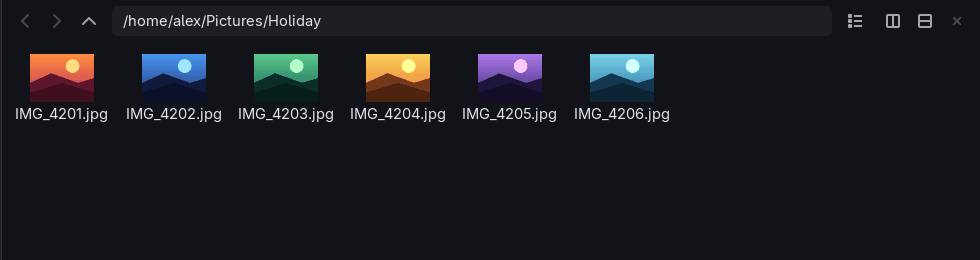

- Only the files on screen get thumbnails, made in the background a few
  at a time. Scrolling past a long folder doesn't make thumbnails for
  everything in it.
- Thumbnails are kept in `~/.cache/thumbnails`, the cache other file
  managers use too, so files they already showed appear at once. A file
  that changes gets a new one.
- Images are read directly. Videos, documents and other types use the
  thumbnailers installed on the system (`ffmpegthumbnailer`,
  `gsf-office-thumbnailer`, …); videos fall back to `ffmpeg` when no
  thumbnailer is installed for them.
- A file that cannot be thumbnailed (damaged, unsupported) keeps its icon
  and isn't tried again until it changes.
- *Settings → Thumbnails* (or `[preview]` in `config.toml`) switches thumbnails off
  and sets the size limit: bigger files keep their icon (50 MiB by default).
  Only local files get thumbnails.

**Folder covers**: a folder holding a picture named `cover`, `folder`,
`front`, `albumart…`, `album` or `.folder` (`.jpg`, `.png`, `.webp`, …, any
case) shows that picture instead of the folder icon, with a small folder
in the corner, which suits music albums and photo sets. When there are
several, they are preferred in that order. Switch it off with *Settings →
Thumbnails → Folder covers* (`folder_covers` in `[preview]`).

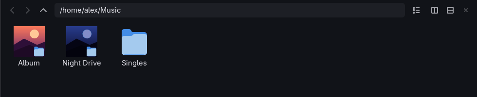

## Sidebar


- **Places**: Home, your standard folders, File System and Trash. The Trash
  icon shows whether it holds anything; right-click it → *Empty Trash…*.
- **Bookmarks**: **Ctrl+D**, or *Add to Bookmarks* in the menu of empty
  space, bookmarks the current folder (again to remove it); a selected
  folder can be bookmarked from its menu too. Drag bookmarks to reorder them; right-click → *Remove Bookmark*.
  Bookmarks from `~/.config/gtk-3.0/bookmarks` (Nautilus, file choosers)
  are shown too, and update as soon as another program changes them.
- **Drives**: see [Drives](#drives).
- **Folder tree** (bottom third): follows the active view, keeping the
  current folder in the middle. Its root is your home folder, or the drive
  the folder is on. Click a folder to open it. The button in its *Folders*
  bar lets the tree fill the whole sidebar; press it again (or
  `:tree toggle`) to bring the places back, with the divider where you
  left it.
- Right-click → *Open in Split* opens a place or a tree folder in a new view
  (see [Split views](#split-views)); middle-click, or right-click → *Open in
  New Window*, opens it in a new window. The Menu key or Shift+F10 opens the
  menu from the keyboard.

## Split views


Up to three views: **left | right-top / right-bottom**.

| Do this | Keys / button |
|---|---|
| Split side by side | Ctrl+\\, ◫ button |
| Split top / bottom | Ctrl+-, ⊟ button |
| Move focus to the next view | F6 |
| Close the active view (or the window if it is the last) | Ctrl+W, ✕ button |

The layout always stays one of these:

- **One view** splits either way: side by side (left | right) or top / bottom.
- **Two views side by side** split top / bottom, and **two views top /
  bottom** split side by side. Either way the view you split becomes
  right-top, the new view right-bottom, and the other view moves to the left.
- **Three views** cannot split further; the buttons that do nothing are
  greyed out.

Right-click a place, bookmark, drive or folder in the tree → *Open in
Split* to open it in a new view: a new right view, or a new right-bottom
view if there is a right one (with three views, right-bottom goes there).

In a narrow window (about 700 px for the views) side-by-side views would be
too cramped, so they stack top / bottom instead, and a single view only
splits top / bottom. Widen the window and they go back side by side.

The view you last used is **active** (accent line under its path bar; the
other views are slightly darker).
Shortcuts, the sidebar and the folder tree act on it. Closing the left view
slides the right column over.

## Search


**Ctrl+F** opens a search field over the active view. Only matching files
stay visible, best match first:

exact name › name without extension › starts with › word inside the name ›
anywhere › letters in order (`dm` finds `dirmodel.c`)

Case is ignored unless you type an uppercase letter.

Type a folder name followed by `/` to search inside that folder: `src/pa`
looks for "pa" in `src`, and `docs/guide/` walks down two levels. The search
only goes down: `..` and `.` are not allowed.

| Key | Action |
|---|---|
| Up / Down | highlight the previous / next match |
| Enter | open the highlighted match (Back returns to where the search started) |
| Esc | show all files again, keeping the match selected; after walking into folders, return to where the search started |

## Working with files

| Menu for selected files | Menu for empty space |
|---|---|
|  | 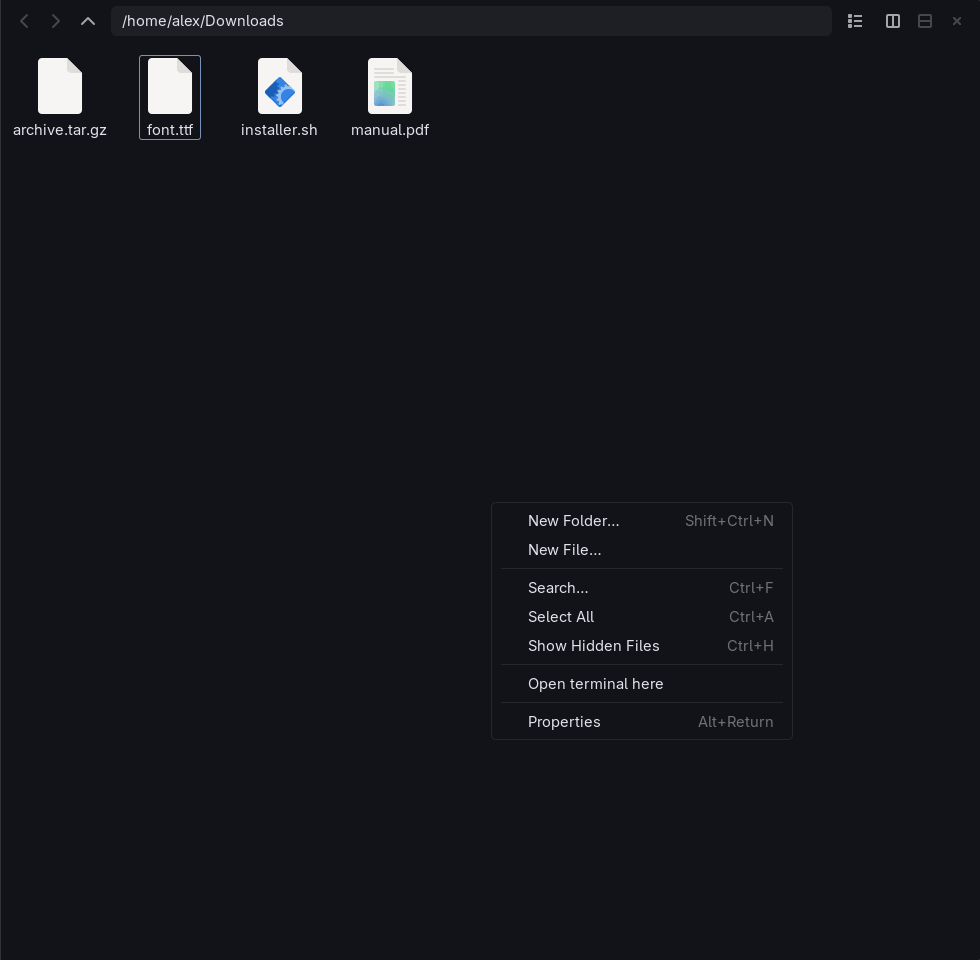 |

| Do this | Keys |
|---|---|
| Copy / cut / paste | Ctrl+C / Ctrl+X / Ctrl+V |
| Move to trash | Delete |
| Delete permanently (asks first) | Shift+Delete |
| Select all | Ctrl+A |
| New folder | Ctrl+Shift+N |
| Open the context menu | right-click, Menu key, Shift+F10 |

- Copy and paste use the system clipboard, so they work between views,
  between windows and with other file managers.
- **Open With** lists the applications installed for the file type.
- Long operations show progress at the bottom, with a cancel button:

  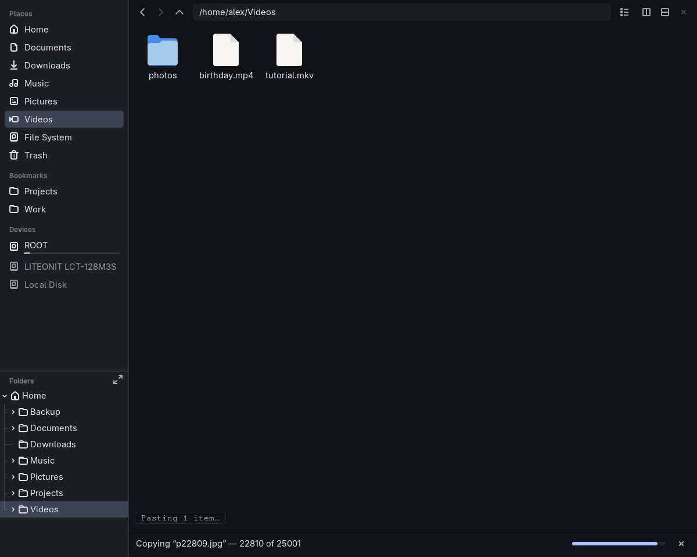

- When a file already exists you can **Replace**, **Skip** or **Keep Both**
  (`name (2).ext`), once or for every conflict. Folders are merged.

  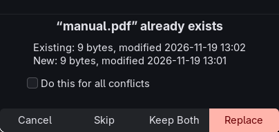

- **Extract Here** (in the menu of archives) unpacks each archive into a new
  folder named after it (`photos.tar.gz` → `photos/`), with progress and
  cancel like a copy. It uses whatever is installed: `bsdtar` (tar, zip, 7z,
  rar, iso), `tar`, `unzip`, `7z` or `unrar`.
- **Compress…** packs the selection into one archive in the current folder.
  Pick the name and the format: zip, tar.gz, tar.xz, tar.zst, 7z or tar
  (only the formats an installed tool can create are listed; sfe remembers
  the last one). It uses `bsdtar`, `tar`, `zip` or `7z`, and never adds to
  an existing archive.

  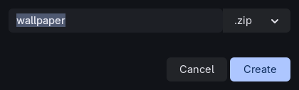
- Trashed files go to the standard trash (`~/.local/share/Trash`), so other
  tools can restore them. Open **Trash** in the sidebar to see them:
  **Restore** puts the selection back where it came from (recreating missing
  folders, never replacing a file that took its place), **Delete** /
  **Shift+Delete** removes items for good, and *Empty Trash…* in the menu of
  empty space clears it. Files trashed on other drives stay in that drive's
  own trash folder (`.Trash-1000`).

### Custom commands

Add your own entries to the context menu in the config file. Each command
is defined for files, for directories, or both (same name, two commands):

```toml
[[actions.directories]]
name = "Open terminal here"
command = "foot -D %f"

[[actions.files]]
name = "Open terminal here"
command = "foot -D %d"

[[actions.files]]
name = "Edit in Neovim"
command = "foot nvim %f"
```

- `%f` is the selected items; with nothing selected it is the current folder
  (which counts as a directory). An argument that is exactly `%f` becomes one
  argument per item; `%f` inside a longer argument is the first item.
- `%d` is the current folder.
- An entry appears when it is defined for everything selected: files,
  directories, or both for a mixed selection. Then files go to the files
  command and directories to the directories command.
- The older `[[actions]]` form still works and applies to both.

## Renaming

**F2** on one file (or *Rename…* in its menu) opens the command line with
`:rename <file> <name>` typed in. The part of the name before the extension
is selected, ready to type over; Enter renames, Esc cancels. Spaces need no
quoting in the new name. *New Folder…* (Ctrl+Shift+N) and *New File…* open
it the same way, with `:mkdir ` and `:touch `.

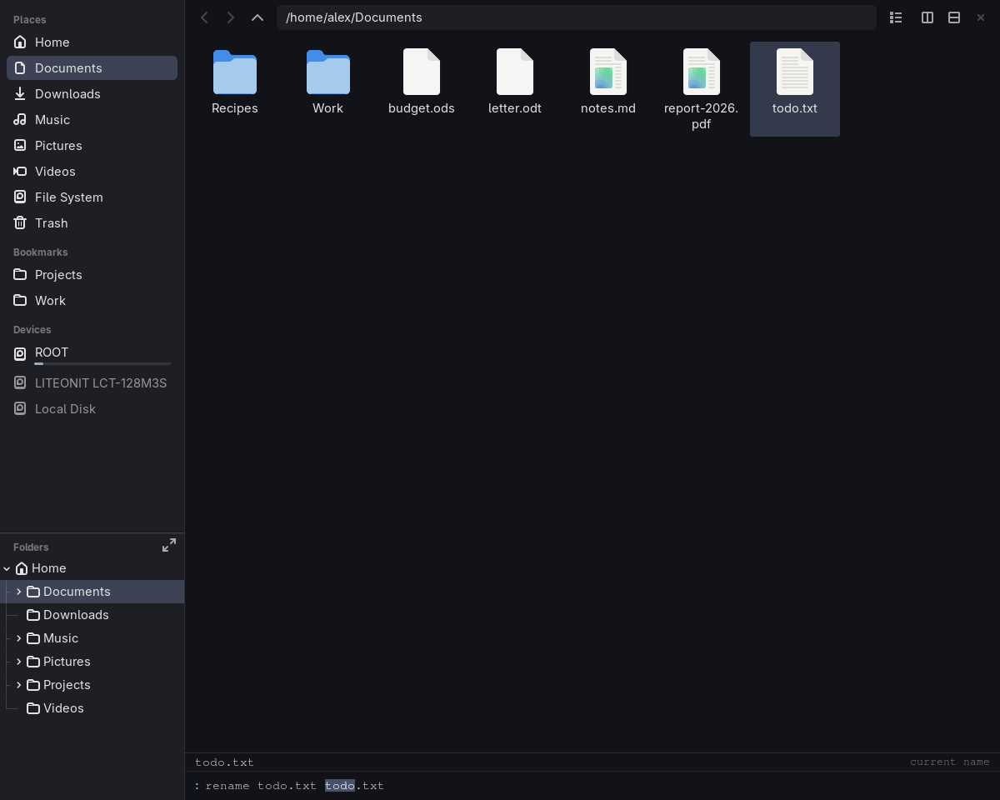

**F2** on several files, or **Shift+F2**, opens the pattern dialog. With
nothing selected, Shift+F2 renames the whole folder, and an **Include: All |
Files | Folders** switch at the top picks which items take part (numbering
counts only those):

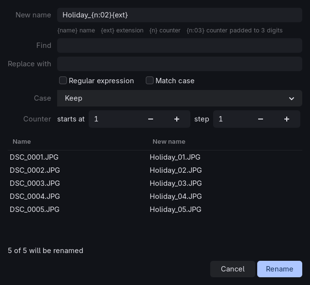

- **New name**: `{name}` (old name without extension), `{ext}` (extension),
  `{n}` (counter), `{n:03}` (counter padded to 3 digits).
- **Find / Replace with**: plain text or a regular expression (`\1` refers to
  groups). Case-insensitive unless *Match case* is on.
- **Case**: keep, lowercase, UPPERCASE, Title Case. **Counter**: start and step.

The preview marks names that would collide. If renaming fails, every file
keeps its old name.

## Undo

**Ctrl+Z**, `u`, or `:undo` takes back the last change to files. sfe keeps
the last 100 changes, from all its windows:

| Change | Undone by |
|---|---|
| copy, paste, new file or folder, link, extract, compress | moving what was made to the trash |
| move, cut and paste | moving the files back (their folder is recreated if it went away) |
| move to trash | bringing the files back from the trash |
| rename, rename with a pattern | giving the files their old names back |

Deleting permanently cannot be undone. A folder merged into one that was
already there is undone file by file, so what was there before stays.

`:undo ` then **Tab** lists the history, newest first, with what each step
did and when; `:undo 2` undoes step 2 even if newer steps came after it.
Typing words of a description (`:undo copy`) narrows the list, and Tab puts
in that step's number. Files that changed since are skipped, and the bar
says how many.

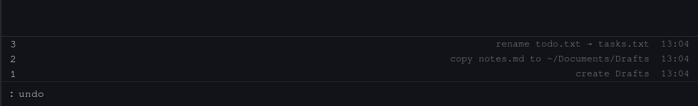

## Properties

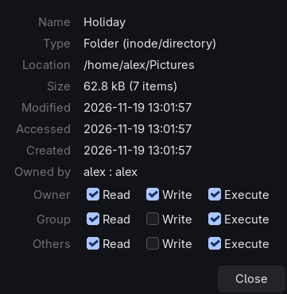

**Alt+Enter** (or *Properties* in the menu) shows type, location, size
(counted in the background for folders), dates and owner. The permission
boxes can be changed directly.

## Drives

Drives appear in the sidebar under *Devices*, named by their label or else
by the drive's vendor and model: mounted disks such as the system disk
first, then disks that can be mounted, then removable drives (flash drives,
SD cards). Mounted drives, the system disk included,
have a thin bar under the name showing how full they are (red above 90%);
hover for the numbers ("94.1 GB used of 2.0 TB (5%) · 1.9 TB free") as well
as the size, filesystem and device.

- **Click** an unmounted drive to mount and open it (USB drives need no password).
- **⏏** unmounts; for USB drives it also powers them off so they can be unplugged.
- Right-click (or the Menu key) offers *Mount*, *Unmount* and *Eject*.

Internal drives ask for an administrator password through your polkit agent.
To allow members of `wheel` to mount them without one, create
`/etc/polkit-1/rules.d/50-udisks.rules`:

```js
polkit.addRule(function(action, subject) {
    if (action.id.indexOf("org.freedesktop.udisks2.filesystem-mount") == 0 &&
        subject.local && subject.active && subject.isInGroup("wheel"))
        return polkit.Result.YES;
});
```

*Settings → Sidebar → Devices* (`devices` under `[sidebar]`) chooses what
is listed: `all` (removable drives and internal disks) or `removable` (only
what can be unplugged, such as flash drives and SD cards).

Encrypted (LUKS) drives are not supported yet.

## Vim-style keys and the command line

Everything works from the keyboard. In the file views single keys are
commands (*normal mode*); text fields (the path bar, the search, the command
line, dialogs) take keys as text, and Esc leaves them. The mouse, the buttons
and the shortcuts below keep working as before.

### Normal-mode keys

`<C-w>v` means Ctrl+W, then V; `H` is Shift+H and `<C-H>` Ctrl+Shift+H.
While a chord is unfinished its keys show in the bottom-right corner. After
half a second a list of the keys that can follow appears above them, with
what each does; the chord then waits for your next key. Esc drops a chord at
once; one left alone without the list is dropped after a second.

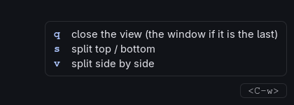

| Keys | Command | Does |
|---|---|---|
| `j` / `k` | `cursor down` / `cursor up` | move the cursor |
| `gg` / `G` | `cursor first` / `cursor last` | first / last item |
| `h`, `<BS>` | `cd ..` | parent folder |
| `l` | `open` | open the folder or file |
| `gh` | `cd ~` | home folder |
| `<C-o>` / `<C-i>` | `back` / `forward` | history |
| `<Space>` | `select toggle` | select or unselect the item, move to the next |
| `yy` | `yank` | copy the selection to the clipboard |
| `dd` | `trash` | move to trash (cut is Ctrl+X or `:cut`) |
| `p` | `paste` | paste into this view |
| `u` | `undo` | undo the last change to files ([Undo](#undo)) |
| `x` / `X` | `trash` / `delete` | move to trash / delete permanently (asks) |
| `r` / `R` | `rename` / `mass_rename` | rename / rename with a pattern |
| `zh` | `hidden toggle` | show / hide hidden files |
| `zz` | `center` | scroll the cursor to the middle of the view (in visual mode the first selected item), and the list back to its left edge |
| `v` | `visual` | visual mode, below |
| `/` | `search` | the fuzzy search |
| `:` | | the command line |
| `<C-w>v` / `<C-w>s` | `split vertical` / `split horizontal` | split side by side / top and bottom (same rules as the buttons) |
| `<C-w>q` | `q` | close the view (the window if it is the last) |
| `W` | `split next` | next view: left, right-top, right-bottom |
| `H` `J` `K` `L` | `split left` / `down` / `up` / `right` | focus the view in that direction; at the edge it wraps around to the far side |
| `<C-H>` `<C-J>` `<C-K>` `<C-L>` | `split move left` / … | swap the active view with the one in that direction (wrapping around too) |

### Visual mode

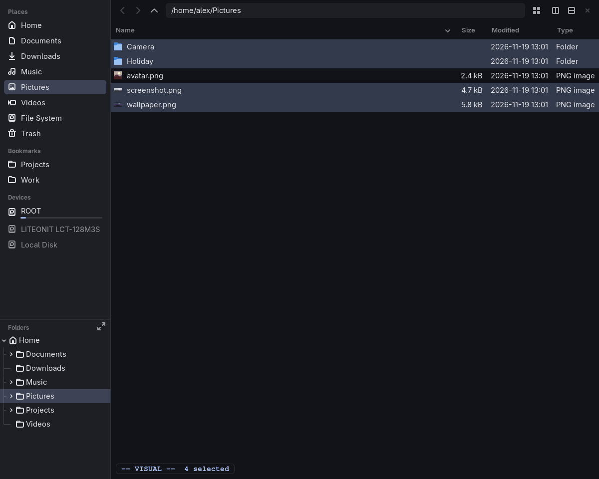

`v` selects with the keyboard. The cursor moves without changing the
selection, and a *chunk* (from where you pressed `v` to the cursor) is
selected like a Shift+click range:

1. `v` starts a chunk; `j` / `k` (`gg`, `G`) stretch it. In a grid `j`
   moves a whole row; `h` / `l` move one item.
2. `v` again ends the chunk: it stays selected and the cursor moves freely.
3. `v` starts the next chunk wherever the cursor is. Chunks add up like
   Ctrl+clicks; `<Space>` adds or removes single items.

The status corner (bottom left) shows `-- VISUAL --` and how many items
are selected; while the command line is open it sits above the command
list. The same corner reports yanking, cutting and pasting for five
seconds: `Yanked 3 files (32 MB)`, `Pasted 2 items (1.0 kB)` (the size is
counted in the background, folders included).

| Keys | Command | Does |
|---|---|---|
| `v` | `visual` | end the chunk / start a new one at the cursor |
| `o` | `visual swap` | jump to the other end of the chunk |
| `h` / `l` | `cursor previous` / `cursor next` | the item before / after |
| `y` | `yank` | copy the selection to the clipboard |
| `d` | `cut` | cut the selection |
| `<Esc>` | `visual off` | leave visual mode |

Other keys work as in normal mode, chords included: `dd` trashes the
selection and `yy` yanks it, so `y` and `d` on their own wait a second for
a possible second key before they run. `x` trashes the selection too, `r` / `R`
rename it, `:` opens the command line for it. Anything that acts on the
files ends visual mode, and so do going to another folder, switching the
view, searching or clicking. Leaving visual mode never changes the
selection.

### The command line

`:` opens a line at the bottom of the views:

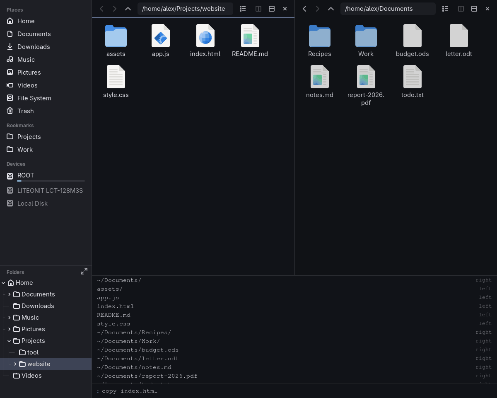

- **Enter** runs the command, **Esc** cancels. Errors stay in the bar, in
  red, until the next key.
- **Tab** / **Shift+Tab** go through the completions; with a single one,
  Tab takes it and goes on (after `Projects/` it lists what is inside).
  **Up** / **Down** walk the commands typed this session.
- Arguments are split like in a shell: `'My Files'`, `"My Files"` or
  `My\ Files`. Completion inserts names already escaped.
- Completion knows where things are: names from the **active view** come
  first (relative to its folder), then the other views clockwise
  (right-top, right-bottom, left) as full paths with `~`. Each line is
  tagged with where it comes from. Within a group the best fuzzy match
  (as in [Search](#search)) comes first, and the letters you typed are
  in the accent colour.
- Command names come one per line with their other names
  (`mkdir | new_directory | new_folder`), the arguments dimmed after
  them and what they do on the right. Tab puts in the name that matched
  best, so `:new_f` + Tab gives `new_folder`. Commands meant for key
  bindings (`cursor`, `select`, `visual`, `center`, `command_line`) come
  last, dimmed.

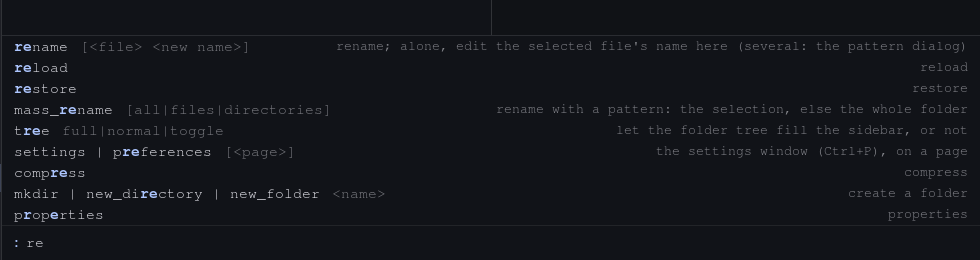

| Command | Arguments | Does |
|---|---|---|
| `cd` | `[<folder>]` | go to a folder (the start folder from Settings → General without one) |
| `open` | `[<file>…]` | open files and folders (the selection without any) |
| `open_with` | `[<application> [<file>…]]` | open with an installed program (Tab lists them, the ones for the selected file's type first): the files given, else the selection, else the current folder; the chooser without a program |
| `cp` (`copy`) | `<file>… <destination>` | copy into a folder |
| `mv` (`move`) | `<file>… <destination>` | move into a folder |
| `ln` (`symlink`) | `<target>… <folder or link name>` | make symbolic links |
| `rename` | `[<file> <new name>]` | rename; alone, puts the selected file's name on the command line to edit (several files: the pattern dialog) |
| `mass_rename` | `[all\|files\|directories]` | rename with a pattern: the selected items (in visual mode or several), else the whole folder; the argument picks what *Include* starts on (`all` without one) |
| `touch` (`new_file`) | `<name>` | create an empty file; spaces are part of the name |
| `mkdir` (`new_directory`, `new_folder`) | `<name>` | create a folder, with the folders on the way; `:mkdir Hello World!` makes one folder “Hello World!” |
| `trash` | `[<file>…]` | move to the trash (the selection without any) |
| `delete` | `[<file>…]` | delete permanently (asks) |
| `yank` (`copy_clipboard`) | `[<file>…]` | copy to the clipboard |
| `cut` | `[<file>…]` | cut to the clipboard |
| `paste` | `[<folder>]` | paste the clipboard here, or into a folder |
| `undo` | `[<step>]` | undo the last change to files, or an older one ([Undo](#undo)) |
| `mount` | `<device>` | mount a drive and open it |
| `unmount` | `<device>` | unmount a drive |
| `eject` | `<device>` | unmount and power off a removable drive |
| `split` | `move\|next\|vertical\|horizontal\|left\|right\|up\|down\|absolute` | the split commands above; `absolute left\|right\|right-top\|right-bottom\|top\|bottom` focuses a position, offering only the ones that exist |
| `q` (`quit`) | | close the active view (the window if it is the last) |
| `bookmark` | `[<folder>…]` | bookmark folders: the ones given, else the selected folders, else this one |
| `unbookmark` | `[<bookmark>…]` | remove sfe's bookmarks the same way |
| `hidden` | `on\|off\|toggle` | show or hide hidden files |
| `sidebar` | `on\|off\|toggle` | show or hide the sidebar (Ctrl+S) |
| `tree` | `full\|normal\|toggle` | let the folder tree fill the sidebar, or not |
| `view` | `grid\|list` | the active view's layout |
| `sort` | `[name\|size\|modified\|type] [ascending\|descending]` | how every view is sorted, saved in the config; either part may be left out (`asc` / `desc` work too), and `:sort` alone flips the direction |
| `settings` (`preferences`) | `[<page>]` | the settings window, on a page: `general`, `thumbnails`, `sidebar`, `keys`, `commands`, `programs`, `system` |
| `cursor` | `down\|up\|first\|last\|previous\|next` | move the cursor (`previous` / `next`: the item before / after) |
| `select` | `toggle\|all` | toggle the item under the cursor / select all |
| `visual` | `[off\|swap]` | visual mode: start it, end / start a chunk; leave it; jump to the chunk's other end |
| `center` | | scroll the cursor (in visual mode the first selected item) to the middle |
| `command_line` |  | open the command line |

`:bookmark` and `:unbookmark` use the selection only when you made it on
purpose: in visual mode, or with several items selected. The item under
the cursor alone doesn't count, since `j` / `k` select what they land on.
Both say so when there is nothing to do.

The menu actions without a command of their own are commands too, with
`-` written as `_`: `:properties`, `:search`, `:reload`,
`:back`, `:forward`, `:up`, `:compress`, `:extract`, `:restore`,
`:empty_trash`, `:location`, `:new_window` and so on; they act on the
selection, like the menu. `:cp` and `:mv` always need a destination
folder: `:cp notes.txt ~/Backup`. For the second and later arguments the
other views' folders are offered first.

Older names (`toggle_hidden`, `view_grid`, `split_vertical`,
`close_pane`, `split close`, `paste_into`, `toggle_sidebar`, …) still work for now, so
key bindings in `config.toml` keep working, but each use says which
command replaces it. They will be removed in a later version.

### Changing the keys

Keys are bound in `config.toml`; an empty command removes a default:

```toml
[keys]
"<C-w>v" = "split vertical"
"gd" = "cd ~/Downloads"
"x" = ""
```

A binding can be any command line, with arguments. Visual mode has its own
table, looked up before `[keys]` while selecting:

```toml
[keys.visual]
"x" = "cut"
```

## Debugging

Run sfe with `G_MESSAGES_DEBUG=sfe sfe` to see debug messages (navigation,
mounting, configuration reloads).

## Configuration

**Ctrl+P** (or `:settings`) opens *Settings*. Changes apply immediately and
are saved to `config.toml`.

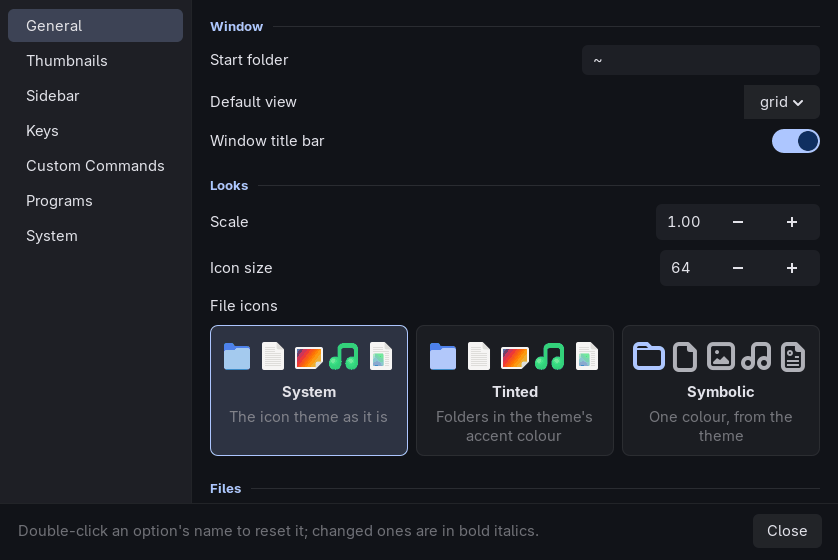

On the General, Thumbnails and Sidebar pages, options you changed have
their name in bold italics, and double-clicking an option's name puts it
back to its default.

- **General**, in three groups: *Window* (start folder, default view,
  window title bar), *Looks* (scale, icon size,
  [file icon style](#file-icons) with a preview of each) and *Files* (hidden
  files, sorting, delete confirmation). *Scale* grows everything: text,
  icons, buttons and the sidebar.
- **Thumbnails**: on or off, the size limit, and folder covers
  ([Thumbnails](#thumbnails)).
- **Sidebar**: which [devices](#drives) are listed, and GTK bookmarks.
- **Keys**: every key with its command and what it does. Double-click a
  command to change it (any command line works, with arguments); *Add…*
  binds new keys, normal or visual mode only; *Unbind* switches a key off;
  *Reset* brings the built-in command back. Changed keys are bold.
- **Custom Commands**: the commands of your own in the right-click menu
  ([Custom commands](#custom-commands)), edited in place: name, command,
  and whether they are for files, folders or both.
- **Programs**: which program opens which extension, as in `[open]`.
- **System**: make sfe the default file manager, [use it for other
  programs' Open / Save dialogs](#open-and-save-dialogs), see the
  [colours taken from the theme](#themes) (hover one for the theme colour
  it came from), open `config.toml`.

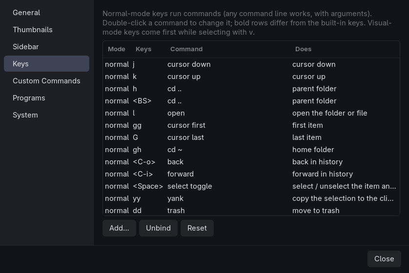

### Open and save dialogs

*Settings → System → Use sfe for Open / Save dialogs* makes programs that ask
the desktop portal for a file dialog (Flatpak apps, browsers) open sfe
instead. A bar at the bottom holds the name to save as, the file types to
show, the program's extra options (an encoding, say), *Cancel* and *Open* /
*Save*; when opening, the selected file is previewed on the right. Unless
the program asked for several files, one item is selected at a time
(Select All and visual mode are off). Enter or a
double-click on a file picks it, Ctrl+Enter is the *Open* / *Save* button.
Firefox and Zen use the portal only with
`about:config` → `widget.use-xdg-desktop-portal.file-picker` set to `1`;
Chromium and Electron apps only when they can reach the session bus
(without systemd, `DBUS_SESSION_BUS_ADDRESS` may need to be set for the
session). The details, troubleshooting, and how to set it up by hand are
in [file-chooser.md](../file-chooser.md).

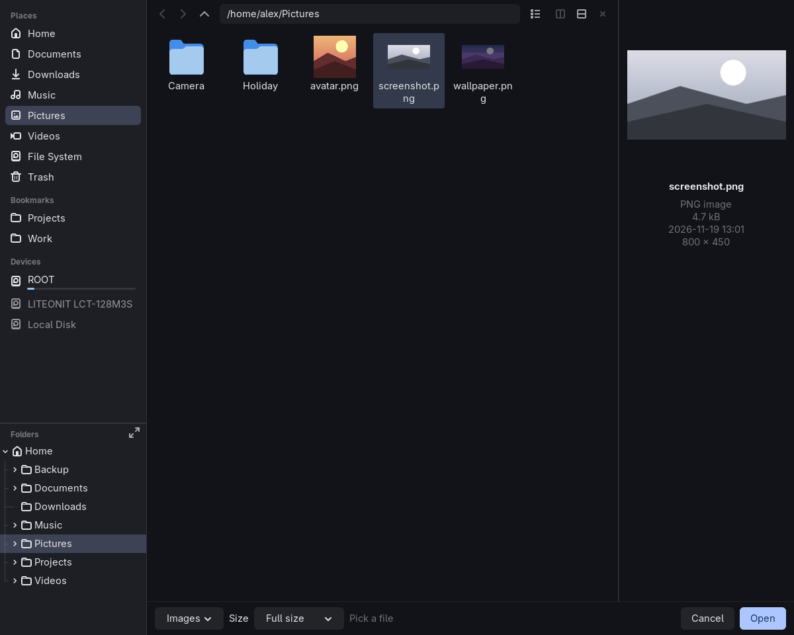

### Default file manager

*Settings → System → Default file manager* makes sfe open folders for other
applications and `xdg-open` (it sets `inode/directory` in `mimeapps.list`).
On first start sfe asks once whether to do this. This needs the installed
`sfe.desktop`, so it is unavailable when running sfe from the build folder.

All settings live in `~/.config/sfe/config.toml`, which is created with
comments on first start. Changes apply while sfe is running.

```toml
[general]
start_path = "~"
show_hidden = false
ui_scale = 1.0
view = "grid"        # grid | list
sort_by = "name"     # name | size | modified | type
sort_order = "ascending"  # ascending | descending

[preview]
thumbnails = true
thumbnail_max_mb = 50

[open]               # program per extension; %f is the file
mp4 = "mpv %f"
pdf = "zathura %f"
```

If the file has a syntax error, or an entry sfe cannot use (an unknown
option, a wrong type), you get a desktop notification with the line
number. A broken file is never overwritten: sfe keeps the previous settings
(or the defaults at start) until you fix it, and skips just the bad entries
otherwise. Notifications use `notify-send` (libnotify) when it is installed.

## Themes

sfe follows your GTK theme and reloads `~/.config/gtk-3.0/gtk.css` as soon as
it changes, so colour schemes from tools like Noctalia, matugen or pywal apply
instantly. The same window with the plain Adwaita theme:

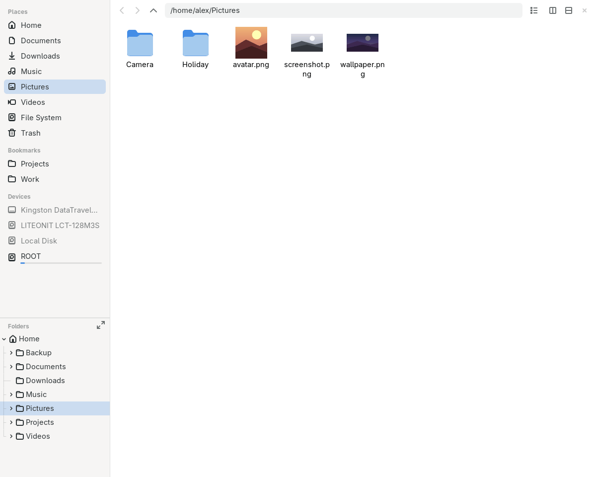

*Settings → System → Theme colours* shows the nine colours sfe uses:
window, text, view, view text, sidebar, accent, accent text, error and
error text. Each
comes from the first colour the theme defines out of the libadwaita name
(`window_bg_color`, `accent_bg_color`, …) and the classic GTK 3 name
(`theme_bg_color`, `theme_selected_bg_color`, …); hovering a swatch says
which. Dimmed ones are sfe's own, because the theme sets neither.

### File icons

Icon themes draw files in fixed colours (Adwaita's folders are always
blue), so sfe can recolour them to match the theme. *Settings → General →
File icons* shows a preview of each style:

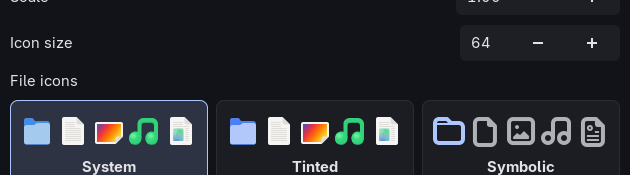

- **System**: the icon theme as it is.
- **Tinted**: folders in the theme's accent colour, keeping their shading;
  files keep their own colours, so types still stand out.
- **Symbolic**: one-colour icons, files in the text colour and folders in
  the accent.

Tinted and symbolic icons follow colour scheme changes live. The sidebar
keeps its own icons. In `config.toml`: `file_icons = "system"`, `"tinted"`
or `"symbolic"` under `[general]`.

## Keyboard shortcuts

Every shortcut in one place. The single-letter keys of normal mode are in
[Vim-style keys](#normal-mode-keys).

| Shortcut | Action |
|---|---|
| Enter | open |
| Backspace | parent folder |
| Alt+Up | parent folder |
| Alt+Left | back |
| Alt+Right | forward |
| Ctrl+L | edit the path |
| F5, Ctrl+R | reload |
| Ctrl+1 | grid view |
| Ctrl+2 | list view |
| Ctrl+H | show / hide hidden files |
| Ctrl+D | bookmark this folder |
| Ctrl+F | search |
| Ctrl+C | copy |
| Ctrl+X | cut |
| Ctrl+V | paste |
| Delete | move to trash |
| Shift+Delete | delete permanently |
| Ctrl+A | select all |
| Esc | clear the selection / close the search |
| Ctrl+Shift+N | new folder |
| F2 | rename |
| Shift+F2 | rename with a pattern |
| Alt+Return | properties |
| Menu, Shift+F10 | context menu |
| Ctrl+\\ | split side by side |
| Ctrl+- | split top / bottom |
| F6 | next view |
| Ctrl+W Q | close the view |
| Ctrl+Z | undo the last change to files |
| Ctrl+P | settings |
| Ctrl+S | hide / show the sidebar |
| Ctrl+N | new window |
| Ctrl+Q | quit |
